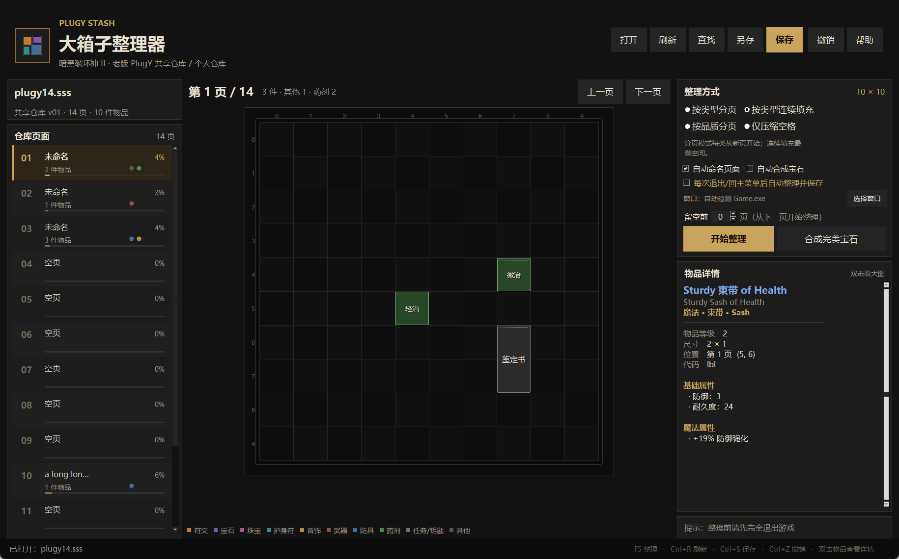

# PlugY 大箱子整理器

一个面向 **老版暗黑破坏神 II（1.10～1.14d）+ PlugY** 的仓库整理工具。  
读取 PlugY 的共享仓库（`.sss`）和个人仓库（`.d2x`），把物品按类型、品质或原顺序重新摆放到 10×10 的大箱子页面里，并能查看每件装备的完整名称和属性。



界面采用深色仓库风格：左侧页面列表显示占用率、物品数和分类色点；中间是圆角物品网格；右侧上方是整理设置，下方是完整物品详情。底部提供常用快捷键提示。  
程序启用了 Windows Per-Monitor V2 高 DPI 感知，并按显示缩放比例放大布局，避免系统对窗口做位图拉伸，文字在 125% / 150% 缩放下更清晰。

## 直接使用

**推荐：双击 `dist\PlugY大箱子整理器.exe`**，不需要安装 Python。
EXE 没有代码签名，Windows SmartScreen 可能提示“未知发布者”；确认文件来源后选择“仍要运行”即可。

如果使用源码版：

1. 安装 Python 3.9 或更高版本；
2. 双击 `启动工具.bat`，或执行 `python main.py`。

## 使用步骤

1. **完全退出游戏和 PlugY 启动器**。游戏运行时写存档会被游戏覆盖，可能造成物品丢失。
2. 双击程序，点击「打开存档」。
   - 共享仓库一般叫 `_LOD_SharedStashSave.sss`；
   - 专家模式共享仓库一般叫 `_LOD_HC_SharedStashSave.sss`；
   - 个人仓库是角色名 `.d2x`。
   - 不知道在哪里可以点「自动查找」。
3. 在右侧选择整理方式，点击「开始整理」。
4. 检查每一页的摆放结果。此时还没有写入文件，可以点「撤销」恢复。
5. 确认无误后点「保存」。程序会先在原文件旁生成带时间戳的 `.bak` 备份，再写入；每个存档只保留最近 5 个备份。

保存后重新进游戏即可看到整理后的仓库。

## 物品名称与详细属性

- 单击格子里的物品，右侧「物品详情」会显示：
  - 中文物品名 + 英文原名
  - 品质、底材类型、物品等级、占格大小、所在页/坐标
  - 基础伤害（武器）、防御、耐久、需求（力量/敏捷/等级）、凹槽
  - 全部魔法属性，例如 `+2 所有技能`、`+45% 伤害强化`、`火焰抗性 +30%`
  - 套装的分段套装加成、符文之语的附加属性、镶嵌物
- **双击物品**会打开一个更大的完整属性窗口，方便查看长属性。
- 暗金、套装、符文之语、底材名称使用暗黑 II 中文译名；魔法前后缀保留原版英文名称（例如 `Sturdy 束带 of Health`），避免错误翻译。
- 属性文字由 `ItemStatCost.txt`、技能表和中文词缀数据生成；目前对测试存档中 90 页、约 3900 条属性做了覆盖检查，没有出现未格式化的内部字段。

## 一键合成完美宝石

右侧可以单独点击「合成完美宝石」，也可以勾选「自动合成宝石」：

- 勾选后，点击「开始整理」会先按原版公式合成宝石，再整理仓库；
- 公式为 **3 颗同级同色宝石 → 1 颗高一级宝石**，会连续升级；
- 例如 9 颗碎裂紫水晶会依次变成 3 颗瑕疵紫水晶，再变成 1 颗普通紫水晶；
- 3 颗无瑕宝石会变成 1 颗完美宝石；
- 合成只改写宝石的物品代码，物品 id 和其他字节不变；
- 被消耗的低级宝石会从仓库删除，每组合成后的宝石保留在其中一个原位置；
- 整理确认框会提前显示预计获得的完美宝石数量和消耗数量；
- 合成结果在保存前可以「撤销」，保存时仍会自动备份。

单独点击「合成完美宝石」则只合成、不整理；合成后可能留下空格，可以再点「开始整理」。

## 整理方式

| 方式 | 说明 |
| --- | --- |
| 按类型分页 | 符文、宝石、珠宝、护身符、首饰、武器、防具、药剂、任务/钥匙、其他，每类从新的一页开始 |
| 按类型连续填充 | 按上述分类顺序排列，但连续填满每页，最省空间（默认） |
| 按品质分页 | 符文之语、暗金、套装、稀有、魔法、超强、普通，各占新页 |
| 仅压缩空格 | 保留物品原来的先后顺序，只把空隙压紧 |

同分类内部的顺序也做了处理：符文按编号从高到低，宝石按种类和品质，装备优先放大件，等等。  
每页固定按 PlugY BigStash 的 **10×10** 网格计算。

### 留空前几页

右侧「留空前 N 页」可以保留仓库最前面的 N 页为空：

- 例如填 `3`，整理后前 3 页为空，所有物品从第 4 页开始摆放；
- 原本在前 3 页的物品也会被移到后面；
- 页数上限是「总页数 - 1」，至少保留一页用来放物品；
- 这个设置会记在配置文件里，下次打开工具继续使用。

### 自动命名页面

右侧「整理后自动命名页面」默认开启。整理完成后：

- 有物品但页名为空的页面会按内容命名；
- 同分类多页会自动编号，例如 `符文 1`、`符文 2`、`符文 3`；
- 单页可能命名为 `首饰`、`武器`、`防具`、`药剂`、`其他`；
- 一页混合多个分类时，用前两个主要分类命名，例如 `武器/防具`；
- 按品质整理时命名为 `暗金`、`套装`、`符文之语`、`魔法` 等；
- 已经有自定义页名的页面不会被覆盖；
- 之前由工具自动命名的页面会在下次整理时更新；
- 留空的页面保持空白，不占用页名。

PlugY 页名会按 GBK 编码写入，并控制在 20 字节以内。

### 每次退出/回主菜单后自动整理

右侧还有一个「每次退出/回主菜单后自动整理并保存」选项：

- 勾选后程序保持运行，自动检测 `Game.exe` / `Diablo II.exe`；
- 如果自动检测不到，可以点「选择窗口」手动指定游戏窗口；
- 手动指定后只监控该窗口，窗口关闭才会触发整理；
- 回到主菜单时角色存档 `.d2s` 更新会被检测到，但**不会在游戏仍运行时写盘**；
- 为避免游戏回写导致仓库损坏，实际整理会等游戏进程完全退出后执行；
- 程序会记录存档目录下所有 `.d2s` 的修改时间；如果没找到 `.d2s`，则只等待游戏进程退出；
- 完全退出后等待 1 秒，重新读取最终存档；
- 重新读取磁盘上的存档，避免使用旧的内存数据；
- 按当前设置自动整理、自动合成宝石、自动命名页面，然后直接保存；
- 保存前仍会生成 `.bak` 备份，每个存档只保留最近 5 个；
- 持续生效：完成后保持勾选，下一局结束并完全退出时会再次自动整理；手动取消勾选才会停止；
- 如果勾选时游戏还没启动，会等待下一次游戏启动并退出；
- 勾选时会明确提示会自动保存；如果当前有未保存的整理结果，会先询问是否保存。

回到主菜单只用于确认本局结束；真正写盘必须等游戏完全退出，避免游戏仍占用/回写存档。自动整理后如果游戏又覆盖了仓库，可以用同目录下的 `.bak` 恢复。

## 安全设计

- **物品二进制数据原样保留**：整理只改写每个物品头部的 X/Y 坐标，以及物品所在的页面。属性、孔、镶嵌物、无形、个人化、任务标记、共享金币、页名和文件末尾的自定义数据都不动。
- **保存前校验**：写盘前会先把结果重新解析一遍，并检查物品是否重叠/越界；失败就取消保存。游戏仍在运行时也会拒绝保存。
- **自动备份**：保存前生成 `原文件名.日期-时间.bak`，每个存档只保留最近 5 个，旧备份自动清理。
- **撤销**：保存前可恢复到上次打开/保存的状态。
- **未知物品保护**：如果遇到原版数据里没有的物品代码，无法确定占格尺寸，工具会停止整理，避免把物品摆重叠。

## 支持范围

- PlugY 共享仓库：`SSS\0` + 版本 `01` / `02`（含共享金币）；
- PlugY 个人仓库：`CSTM` + 版本 `01`；
- 暗黑 II 1.10～1.14d 的原版物品数据（1.13c 是主要测试目标）；
- PlugY BigStash 10×10 页面，页数不限；
- Windows 10 / 11。

已知限制：

- **不支持修改过物品数据表的模组**。如果存档里出现工具不认识的物品属性，会提示“可能是模组存档”并拒绝打开，这是为了避免误判物品长度后写坏存档。
- 不支持 PlugY 页面改名、插入/删除页面、修改物品属性。
- 不是 D2R（暗黑 II 重制版）仓库工具。

## 常见问题

**保存后游戏提示 “Unable to enter game / Bad inventory data”**

说明写入的数据没有被游戏接受。请完全退出游戏，然后用同目录下最新的 `.bak` 覆盖回原文件：

```text
_LOD_SharedStashSave.sss.20261110-143000.bak
→ 改回 _LOD_SharedStashSave.sss
```

**提示“物品属性 ID 不在原版 1.14d 数据中”**

这个存档使用了模组/自定义物品数据表，当前工具按原版数据解析，不能安全处理。请先备份，并不要强行保存。

**打开后页面数量很多，但大部分是空的**

PlugY 会保留历史页面。整理只使用前面的页面，不会删除空页，所以页数可能不变。

**共享金币会变吗？**

不会。版本 `02` 的共享金币原样保留。

## 从源码运行 / 开发

```powershell
python main.py
python -m unittest discover -s tests -v
```

目录结构：

```text
main.py                  启动入口
plugy_stash/
  bitstream.py           D2 的 LSB-first 位读写
  stash.py               .sss / .d2x 解析与写回
  sorter.py              分类、装箱、生成整理方案
  naming.py              根据页面内容自动命名
  backups.py             备份保留最近 5 个
  gems.py                宝石 3→1 升级
  gamewatch.py           检测游戏进程是否已退出
  props.py               物品名称、属性格式化和详情窗口数据
  gamedata.py            物品数据加载
  ui.py                  Tkinter 界面
  zh.py                  分类、颜色和基础中文名
data/
  items.json             物品代码、占格、堆叠、基础伤害/防御/需求
  stats.json             物品属性位宽表（1.14d）
  stat_desc.json         属性描述模板和中文文本
  zh_items.json          物品/技能中文译名
  affixes.json           魔法前后缀、稀有词、符文之语名称
  names.json             暗金/套装英文名称
tests/                   解析、回写、整理、属性格式化测试
tools/build_data.py      基础物品数据生成脚本（开发用）
tools/build_extended_data.py  名称和属性数据生成脚本（开发用）
```

重新打包 EXE：

```powershell
python -m PyInstaller --noconfirm --clean --onefile --windowed `
  --name PlugYStashSorter --icon assets\icon.ico `
  --manifest assets\app.manifest --add-data "assets;assets" `
  --add-data "data;data" main.py
```

## 致谢与说明

格式与解析参考了：

- [PlugY save files structures — The Phrozen Keep](https://www.d2mods.info/forum/viewtopic.php?f=133&t=31359)
- [squeek502/d2itemreader](https://github.com/squeek502/d2itemreader)（Public Domain）及其 PlugY 格式文档
- [ChaosMarc/PlugY](https://github.com/ChaosMarc/PlugY) 的 BigStash / InfinityStash 源码
- [pinkufairy/D2R-Excel](https://github.com/pinkufairy/D2R-Excel) 的基础物品、词缀、技能数据
- [fabd/diablo2](https://github.com/fabd/diablo2) 的 1.13 英文字符串表
- [awdrrawd/D2R-storehouse](https://github.com/awdrrawd/D2R-storehouse) 的中英文物品/词缀翻译数据（MIT）

本工具与暴雪娱乐、PlugY 作者无隶属关系，不包含游戏图像、音频等资源。暗黑破坏神 II 及相关名称归 Blizzard Entertainment 所有。请仅用于个人存档整理，并自行承担修改存档的风险。
